 

> **Rimba × Clawd** — cerita singkat tentang satu hari ngoding Marryio bareng Claude. Semua 31 emosi Clawd muncul di sini. Mari baca dari atas. ↓

---

## 🐍 Ular Lapar

&nbsp;&nbsp;&nbsp;&nbsp;

Clawd: "tolong jangan makan commit-ku..."

---

## 🎒 Inventory

---

## 📖 Cerita

---

## ⭐ Stats Board

&nbsp;&nbsp;

---

Clawd & animasi oleh <a href="https://github.com/JohnHeibel/ClaudeAnimationBase">JohnHeibel/ClaudeAnimationBase</a> (MIT) · lisensi di <code>assets/CLAWD-LICENSE.txt</code>

 

[rimba.dev](https://rimba-dev.caesarbimantara00.workers.dev/) · [marryio.id](https://marryio.id/) · [@ccbmantara](https://instagram.com/ccbmantara) · Discord: gaztorgat

