

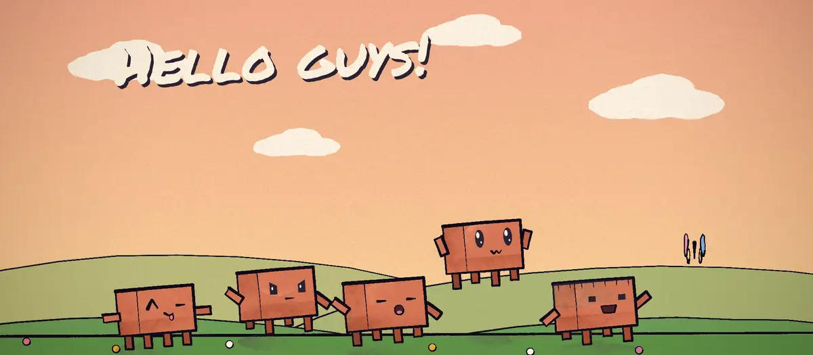

 

> **Rimba × Claude** — addicted to building, consistent in learning.

---

## 🐍 Hungry Snake

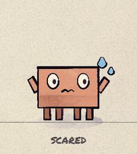&nbsp;&nbsp;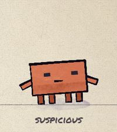&nbsp;&nbsp;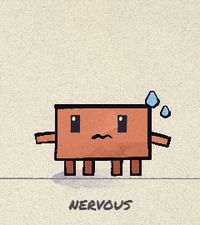

Clawd: "please don't eat my commits..."

---

## 🎒 Inventory

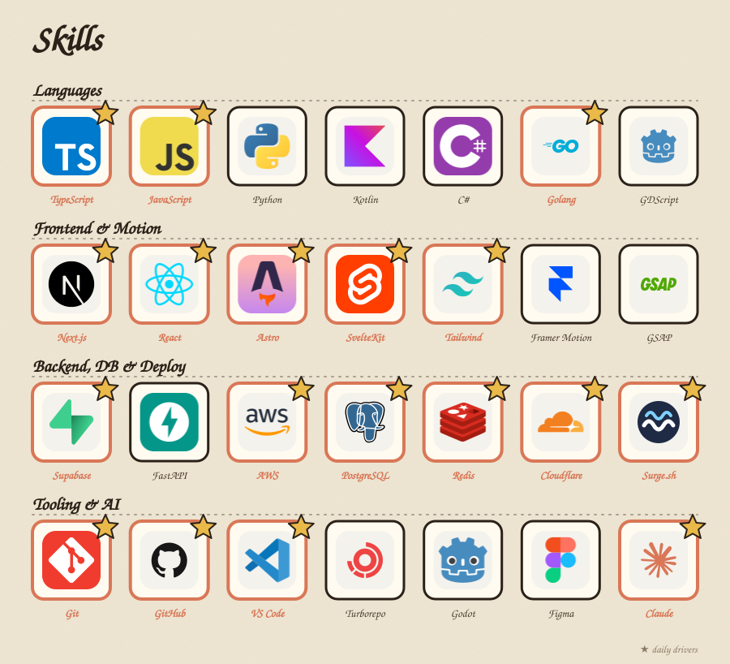

---

## 📖 The Story

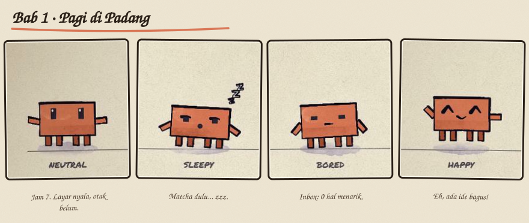
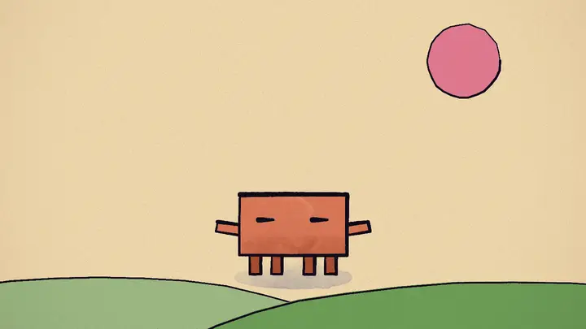

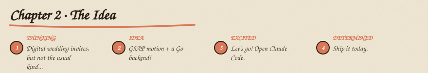
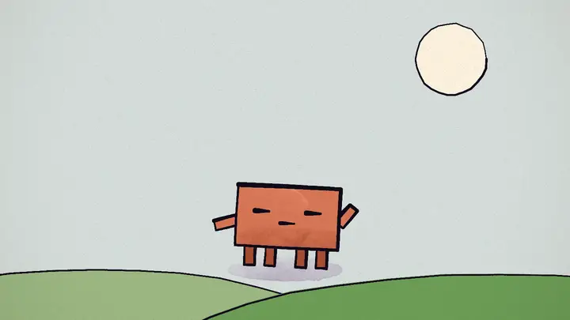

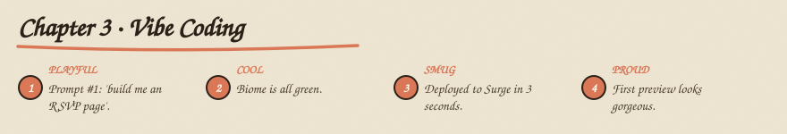
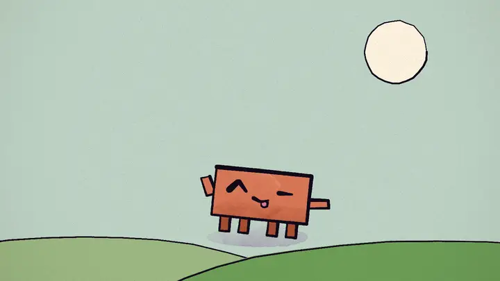

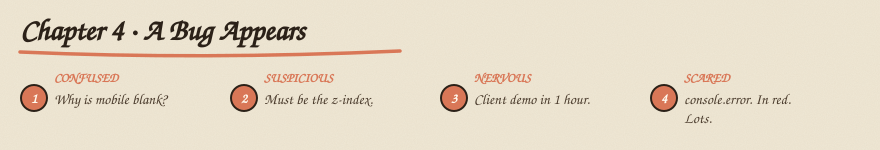
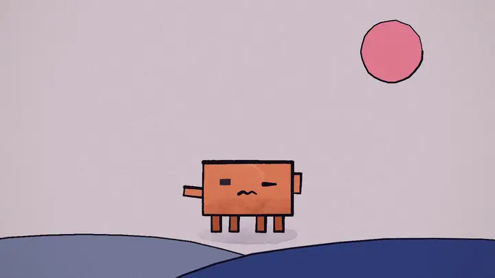

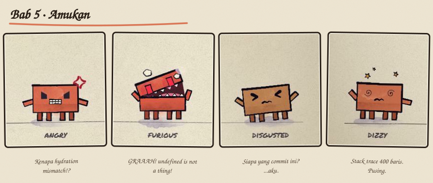
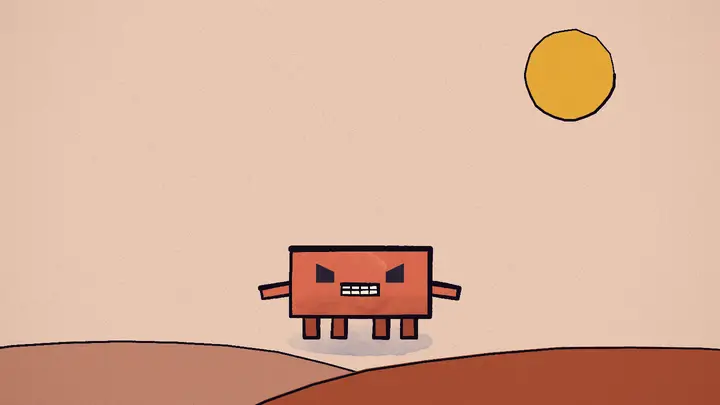

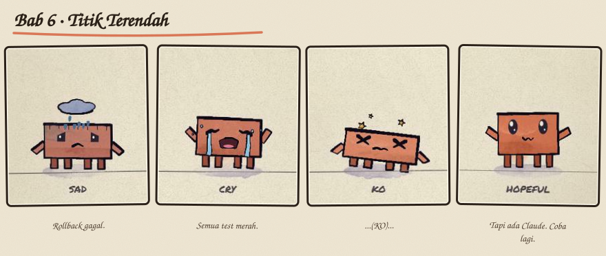
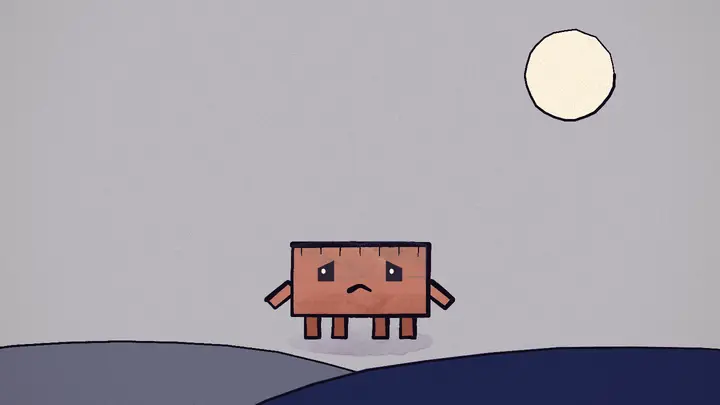

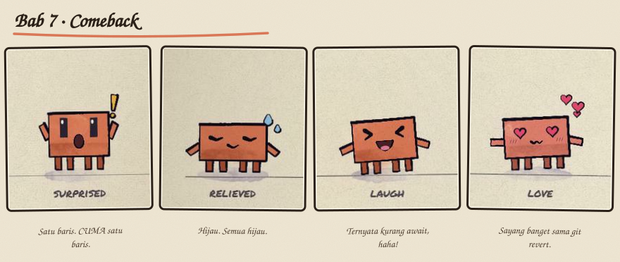
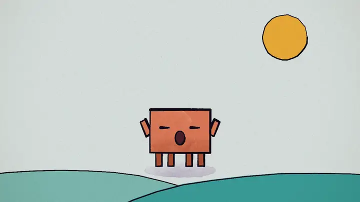

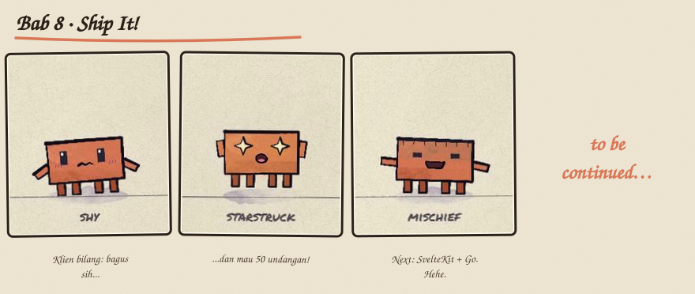
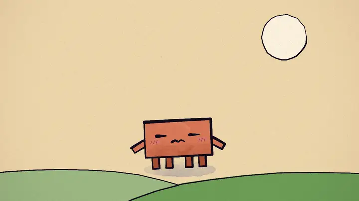

---

## ⭐ Stats Board

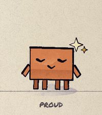&nbsp;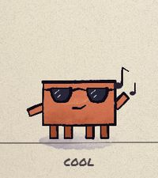&nbsp;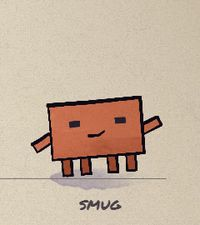

---

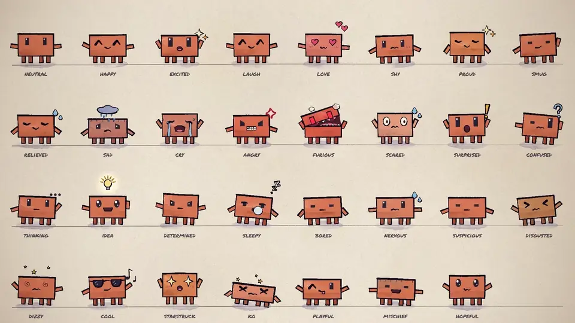

Clawd & animation kit by <a href="https://github.com/JohnHeibel/ClaudeAnimationBase">JohnHeibel/ClaudeAnimationBase</a> (MIT) · license in <code>assets/CLAWD-LICENSE.txt</code>

 

[rimba.dev](https://rimba-dev.caesarbimantara00.workers.dev/) · [marryio.id](https://marryio.id/) · [@ccbmantara](https://instagram.com/ccbmantara) · Discord: gaztorgat

