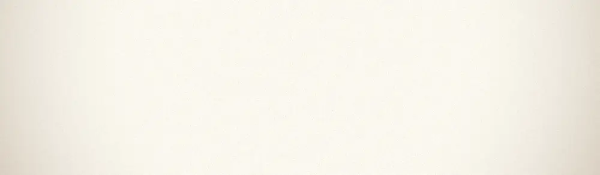
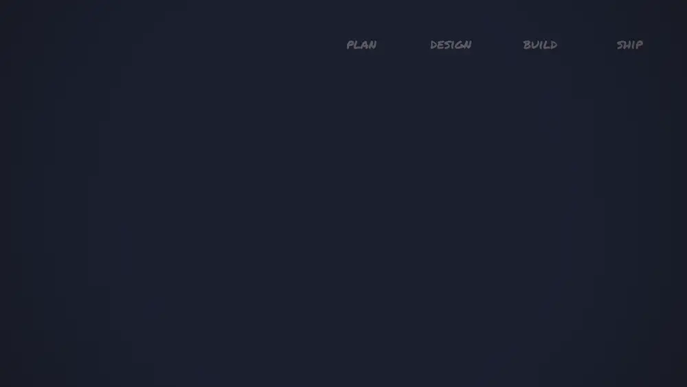
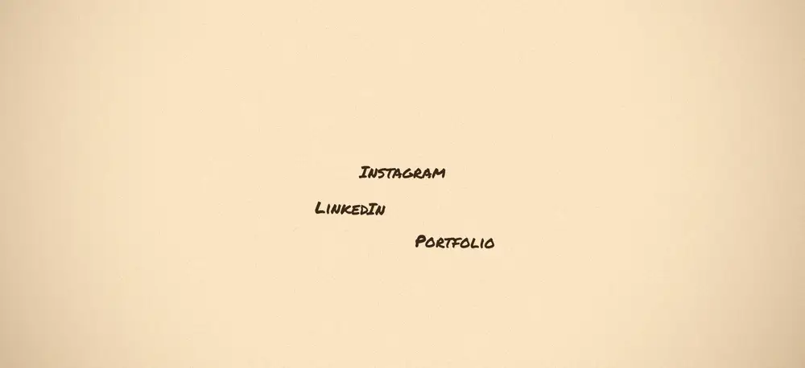

 

> **Rimba × Claude** — addicted to building, consistent in learning.

---

## 🌿 Forest Feast

---

## 🌳 Skills

---

## 📖 The Story

---

## 🧭 Find Me

  

Clawd & animation kit by <a href="https://github.com/JohnHeibel/ClaudeAnimationBase">JohnHeibel/ClaudeAnimationBase</a> (MIT) · license in <code>assets/CLAWD-LICENSE.txt</code>

